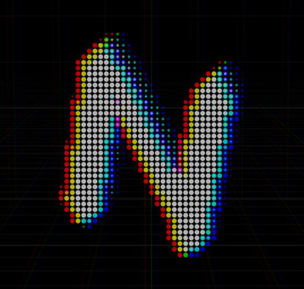

<p align="center">
  
</p>

<h1 align="center">Nithin's Portfolio</h1>

Hi, I'm Nithin, an engineer at Amazon working on evals and AI infrastructure. This is the code for my personal
site, [nithinsrinivasan.com](https://nithinsrinivasan.com), where I share what I've built and write about what I'm figuring out.

Built with Next.js, React, TypeScript, Tailwind, Three.js and MDX.

## Under the hood

**The Game:** Hidden in the contact section is an Asteroids-style game where you squash bugs. I wrote the engine
from scratch on a 2D canvas, with no game library. The sprites are pixel art drawn as text grids and tinted per
species, and each frame is finished on the GPU with bloom, chromatic aberration and scanlines. It lives in
`src/features/contact/asteroids`.

**The Agent:** The About chat answers questions as me. It's a small tool-calling agent that can read my blog
posts, but it only answers from what I wrote in `content/chat` and can only link to things I've approved. Every
request clears a rate limit and a daily spend ceiling before it reaches the model. It lives in
`src/features/chat`.

**The Shaders:** The N in the hero is extruded 3D geometry run through my own post-processing pass, which dithers
it into dots and glitches it with horizontal slices and a split of its colour channels. Behind it is a noise
field drawn in GLSL. It lives in `src/features/n-glyph/scene`.

## Running it

You'll need [bun](https://bun.sh).

```sh
bun install
cp .env.example .env.local   # add OPENROUTER_API_KEY to turn on the chat
bun run dev                  # http://localhost:3000
```

## Where to look next

[docs/ARCHITECTURE.md](docs/ARCHITECTURE.md) maps the code. [AGENTS.md](AGENTS.md) covers how to work on it.

## Thanks for stopping by

This site is my playground, so it'll keep changing as I learn and build new things. If you find a bug, have an
idea, or just want to talk about evals, agents or distributed systems, I'd love to hear from you at
[nithin2803@gmail.com](mailto:nithin2803@gmail.com).
